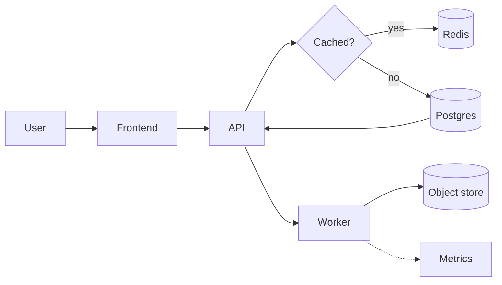

Redraw this Mermaid diagram as a proper diagram. Save it as one self-contained HTML file in the current directory. I am not available for questions: keep the default style and proceed with your best judgment.

